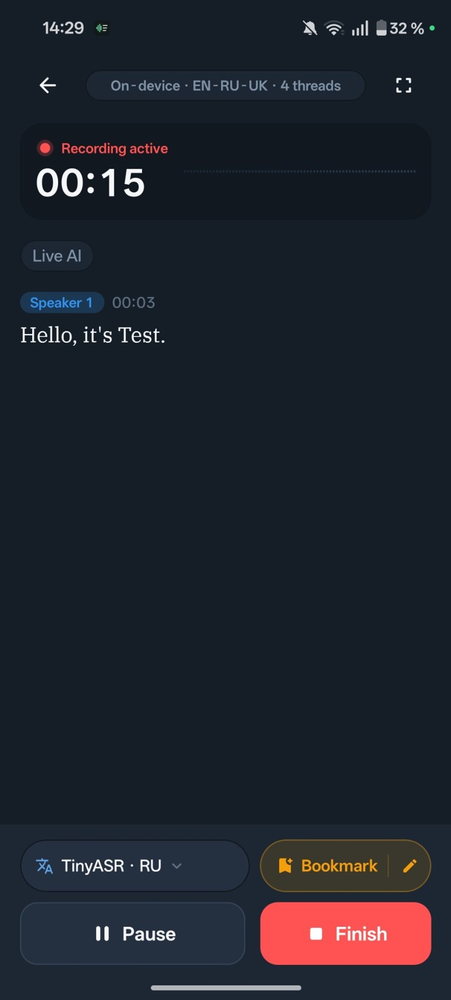
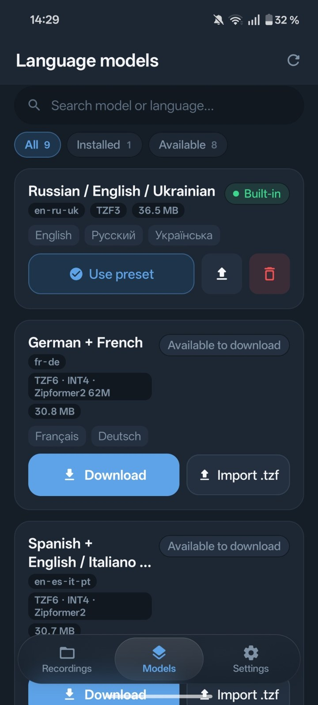
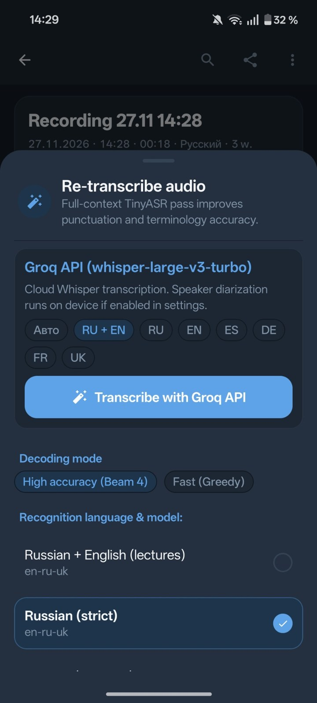
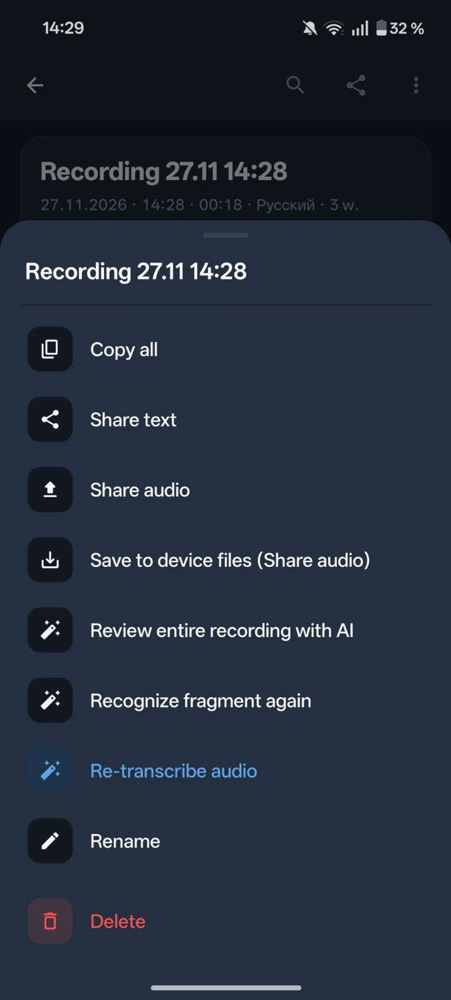
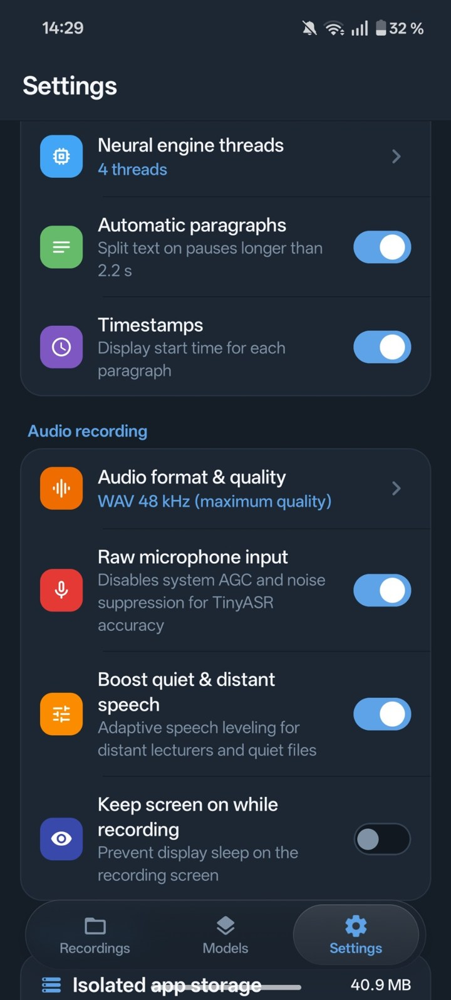

# Vanta for Android

**English** · [Русский](README.ru.md)

Vanta records audio and turns speech into text as you record. Use it in lectures and seminars to revisit anything you missed, or to review interviews, meetings, and voice notes. The original audio stays available for playback and a second transcription pass.

## Features

- On-device transcription with TinyASR and a built-in Russian, English, and Ukrainian model.
- Downloadable language packs and local `.tzf` model import.
- Bookmarks, timestamps, automatic paragraphs, and optional speaker labels.
- Re-transcription on device or through Groq’s Whisper Large V3 Turbo. The optional Groq mode requires an API key and sends audio to Groq.
- Transcript export to TXT, SRT, PDF, or DOCX, plus separate audio sharing.

## Screenshots

| Live transcription | Language models | Re-transcription |
| :---: | :---: | :---: |
|  |  |  |

| Recording actions | Recording settings |
| :---: | :---: |
|  |  |

## Building

Vanta targets Android 8.0 and later. The Gradle project uses JDK 17, Android SDK 35, NDK 27.2.12479018, and CMake 3.22.1. A complete local checkout requires the native archives and model assets bundled in the original source package.

With the complete project open in Android Studio, sync Gradle and run the `app` module. To build from a terminal, run `./gradlew assembleDebug` (`gradlew.bat assembleDebug` on Windows). The output is under `app/build/outputs/apk/debug/`.

## License

The original Vanta code is released under the [MIT License](LICENSE). You may use, modify, and redistribute it, including commercially, with the license notice retained. It is provided **as is**, without warranty. Third-party components retain their own terms, including [TinyASR under GPL-3.0-or-later](native/tinyasr/LICENSE) and the [notices for bundled models](app/src/main/assets/models).
