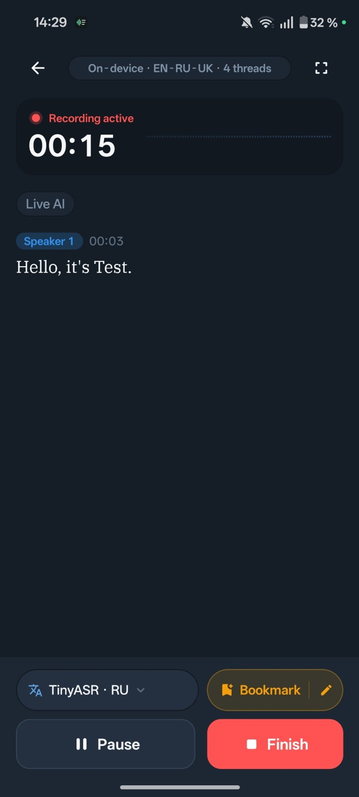
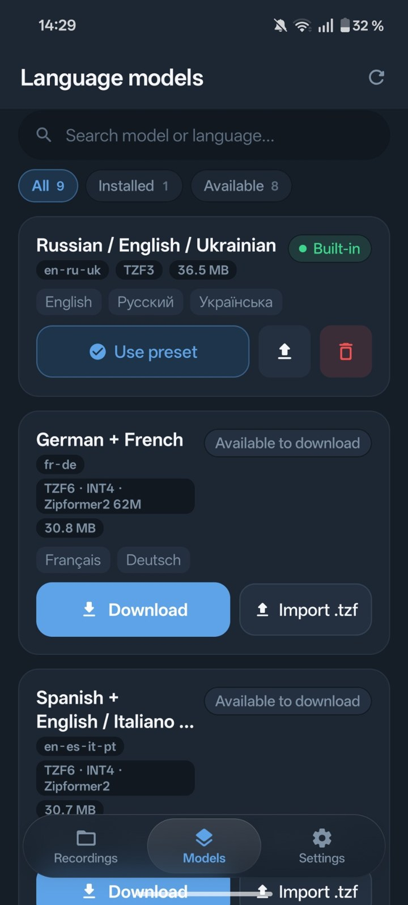
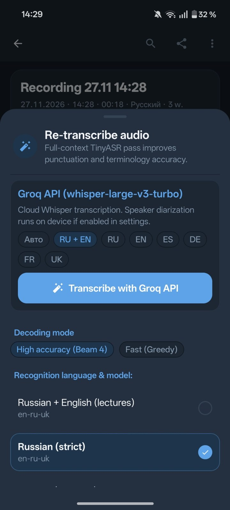
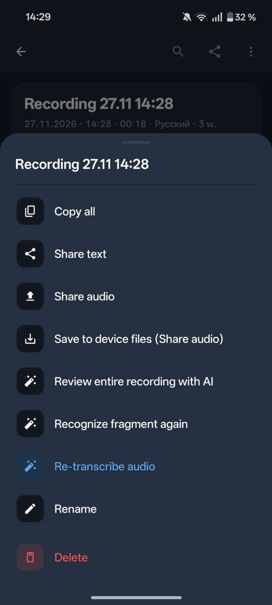
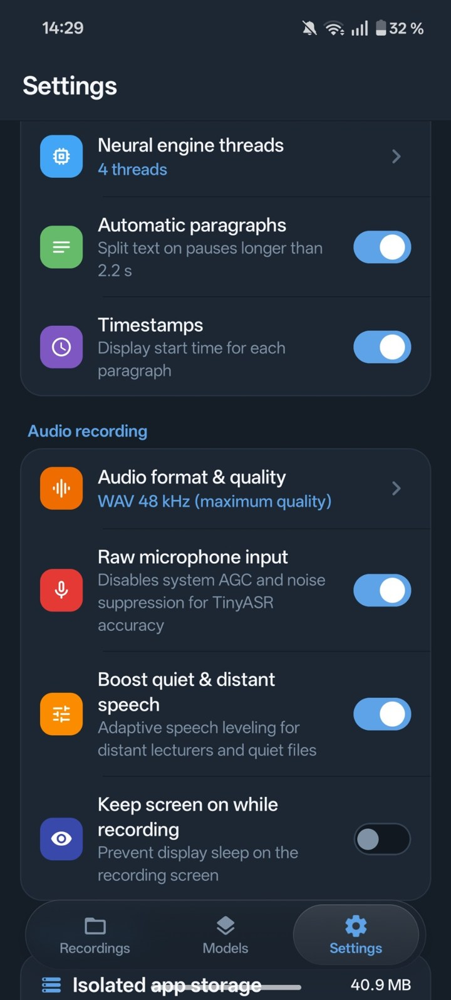

# Vanta для Android

[English](README.md) · **Русский**

Vanta записывает звук и расшифровывает речь прямо во время записи. Приложение удобно на лекциях и семинарах, когда нужно вернуться к пропущенному фрагменту. Оно также подходит для интервью, встреч и голосовых заметок. Исходное аудио можно прослушать и расшифровать повторно.

## Возможности

- Распознавание речи на устройстве через TinyASR. Встроенная модель поддерживает русский, английский и украинский.
- Загрузка языковых пакетов и импорт локальных моделей `.tzf`.
- Закладки, временные метки, автоматические абзацы и опциональные метки говорящих.
- Повторная расшифровка на устройстве или через Whisper Large V3 Turbo в Groq. Для облачного режима нужен API-ключ, аудио отправляется в Groq.
- Экспорт текста в TXT, SRT, PDF и DOCX. Аудиозаписью можно поделиться отдельно.

## Скриншоты

| Расшифровка во время записи | Языковые модели | Повторная расшифровка |
| :---: | :---: | :---: |
|  |  |  |

| Действия с записью | Настройки записи |
| :---: | :---: |
|  |  |

## Сборка

Vanta работает на Android 8.0 и новее. Для сборки нужны JDK 17, Android SDK 35, NDK 27.2.12479018 и CMake 3.22.1. Для локальной сборки также нужны нативные архивы и файлы моделей из полного архива исходников.

Откройте полный проект в Android Studio, синхронизируйте Gradle и запустите модуль `app`. Для сборки из терминала выполните `./gradlew assembleDebug` (на Windows — `gradlew.bat assembleDebug`). APK появится в `app/build/outputs/apk/debug/`.

## Лицензия

Авторский код Vanta доступен по [лицензии MIT](LICENSE). Код можно использовать, изменять и распространять, в том числе коммерчески, с сохранением текста лицензии. Код предоставляется **как есть**, без гарантий. На сторонние компоненты действуют их собственные условия, включая [GPL-3.0-or-later для TinyASR](native/tinyasr/LICENSE) и [лицензии моделей](app/src/main/assets/models).
